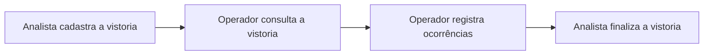
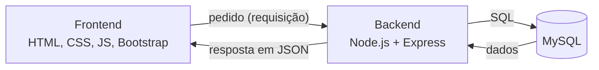

# 01 - Conceito

## Problema

Empresas que fazem vistorias prediais precisam controlar as vistorias realizadas em campo e os problemas encontrados em cada uma. Quando esse controle é feito em papel ou planilhas, informações se perdem e fica difícil consultar o histórico.

## Solução

O **Vistoria Informatizada** é um sistema web em que:

1. O **Analista** cadastra a vistoria: endereço, foto do local, descrição com as informações iniciais e o operador responsável.
2. O **Operador** consulta a lista de vistorias e registra as **ocorrências** encontradas, com classificação, descrição e foto.
3. O Analista acompanha as ocorrências e marca a vistoria como **finalizada**.
4. Todas as ocorrências ficam guardadas e podem ser consultadas a qualquer momento.

## Perfis de usuário

| Perfil | Quem é | O que faz no sistema |
|---|---|---|
| Analista | Funcionário do escritório | Cadastra e acompanha vistorias, gerencia usuários |
| Operador | Vistoriador que vai a campo | Registra as ocorrências das vistorias |

## Glossário

| Termo | Significado |
|---|---|
| Vistoria | Inspeção feita em um imóvel |
| Ocorrência | Problema encontrado durante a vistoria (ex.: infiltração, rachadura) |
| Classificação | Gravidade da ocorrência: Baixa, Média, Alta ou Crítica |
| Status | Situação da vistoria: Aberta ou Finalizada |
| Cargo | Perfil do usuário: Analista ou Operador |
| Permissão | Ação que um cargo pode realizar |

## Fluxo principal

## Arquitetura

- O **frontend** é o que o usuário vê no navegador.
- O **backend** recebe os pedidos do frontend, consulta o banco de dados e devolve a resposta.
- O **banco de dados** guarda todas as informações.

Os detalhes de funcionamento do backend estão em [04-backend.md](04-backend.md).
