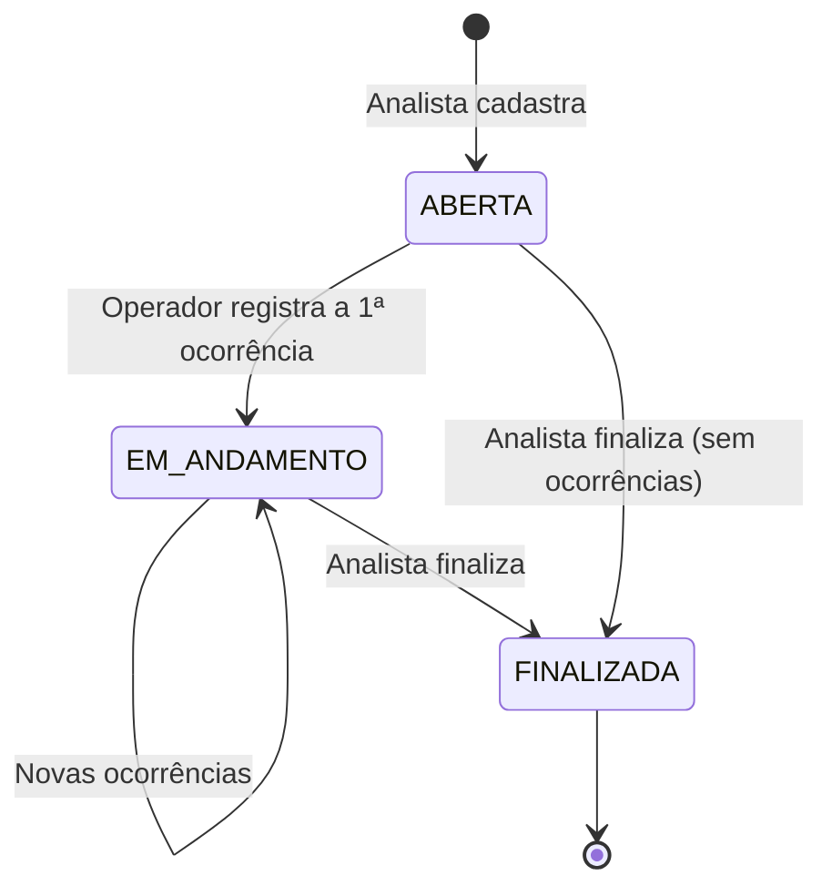
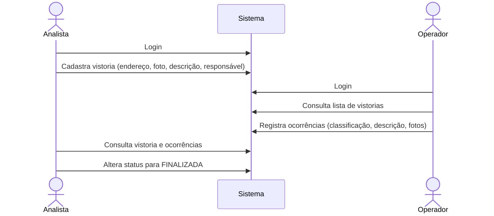
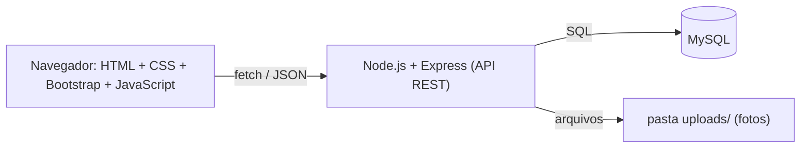

# 01 - Conceito do Produto

## Nome

**Vistoria Informatizada**

## Problema

Fornecedores que realizam vistorias prediais em campo precisam de uma solução sistematizada para gerenciar as vistorias, registrar as ocorrências identificadas e **manter o histórico** de tudo. Hoje esse controle costuma ser feito em papel ou planilhas, o que gera perda de informação, falta de padronização e dificuldade para acompanhar o andamento.

## Solução

Um sistema web simples, acessado pelo navegador, em que:

1. O **Analista** cadastra a vistoria a ser feita: endereço, foto do local, informações iniciais e o operador responsável.
2. O **Operador** (vistoriador) consulta as vistorias e, em campo, registra **uma ou mais ocorrências** para cada uma — com classificação, data, descrição e fotos.
3. O Analista acompanha o andamento e **finaliza** a vistoria quando concluída.
4. Todo o histórico de ocorrências fica disponível para consulta.

## Público-alvo / Perfis

| Perfil | Quem é | Objetivo no sistema |
|---|---|---|
| **Analista** | Funcionário do escritório que planeja as vistorias | Cadastrar e acompanhar vistorias, gerenciar usuários |
| **Operador** | Vistoriador que vai a campo | Registrar ocorrências encontradas nas vistorias |

## Glossário

| Termo | Significado |
|---|---|
| **Vistoria** | Inspeção agendada em um imóvel/endereço |
| **Ocorrência** | Problema ou observação encontrada durante a vistoria (ex.: infiltração, fissura) |
| **Classificação** | Gravidade da ocorrência: Baixa, Média, Alta ou Crítica |
| **Status** | Situação da vistoria: Aberta, Em andamento ou Finalizada |
| **Cargo** | Perfil do usuário (Analista ou Operador) |
| **Permissão** | Ação que um cargo pode executar no sistema |

## Ciclo de vida da vistoria

## Fluxo principal

## Arquitetura

- Um **único projeto Node.js** serve a API (`/api/...`) e os arquivos do frontend (pasta `public/`).
- As fotos são salvas na pasta `uploads/`; o banco guarda apenas o caminho da imagem.
- O login gera um **token JWT** que o frontend envia em todas as requisições (`Authorization: Bearer <token>`).

## Segurança

- Senhas armazenadas apenas como **hash bcrypt**.
- Toda rota (exceto login) exige token válido.
- Cada rota verifica se o cargo do usuário tem a **permissão** necessária.
- **Teclado virtual na tela de login:** conforme a SA, a senha não é digitada pelo teclado físico; o usuário clica em botões na tela (proteção contra keyloggers). Isso é implementado no frontend.
