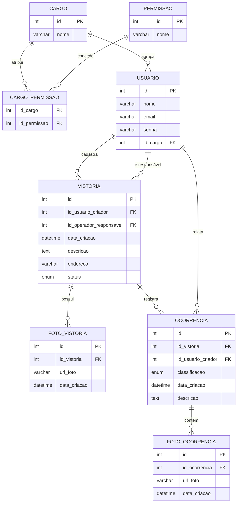

# 03 - Banco de Dados

Banco MySQL chamado `vistoria_informatizada`. Os scripts estão na pasta [`database/`](../database):

- `01-schema.sql` — cria o banco e as tabelas
- `02-seed.sql` — insere cargos, permissões, usuários de teste e um exemplo de vistoria

## Diagrama

## Tabelas

| Tabela | Para que serve |
|---|---|
| `cargo` | Perfis do sistema: Analista e Operador |
| `permissao` | Ações que podem ser liberadas para um cargo |
| `cargo_permissao` | Diz quais permissões cada cargo tem |
| `usuario` | Pessoas que acessam o sistema |
| `vistoria` | Vistorias cadastradas pelo analista |
| `foto_vistoria` | Fotos do local da vistoria (link da imagem) |
| `ocorrencia` | Problemas registrados pelo operador em uma vistoria |
| `foto_ocorrencia` | Fotos de cada ocorrência (link da imagem) |

## Permissões de cada cargo

| Permissão | Analista | Operador |
|---|:---:|:---:|
| GERENCIAR_USUARIOS | ✅ | |
| GERENCIAR_VISTORIAS | ✅ | |
| VISUALIZAR_VISTORIAS | ✅ | ✅ |
| REGISTRAR_OCORRENCIAS | | ✅ |
| VISUALIZAR_OCORRENCIAS | ✅ | ✅ |

## Valores fixos (ENUM)

| Campo | Valores |
|---|---|
| `vistoria.status` | `ABERTA`, `FINALIZADA` |
| `ocorrencia.classificacao` | `BAIXA`, `MEDIA`, `ALTA`, `CRITICA` |

## Observações

- As fotos são salvas como **link** (texto) no campo `url_foto`.
- `ON DELETE CASCADE`: ao excluir uma vistoria, o MySQL exclui automaticamente suas fotos e ocorrências.
