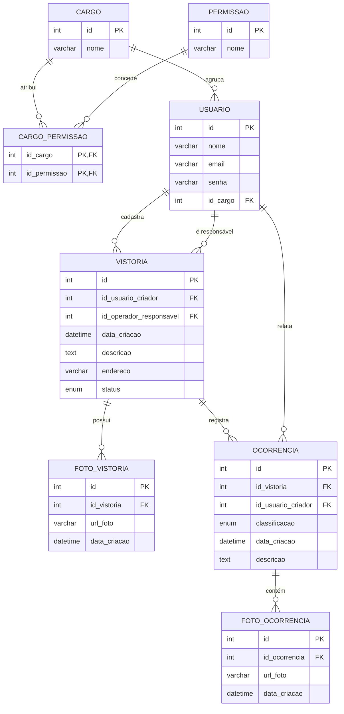
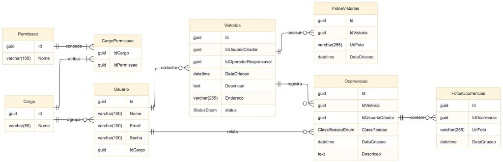

# 03 - Banco de Dados

Banco **MySQL 8**: `vistoria_informatizada`. Scripts em [`database/`](../database).

## DER

Rascunho original do DER:

### Decisões sobre o rascunho

| Rascunho | Implementado | Motivo |
|---|---|---|
| `guid` | `INT AUTO_INCREMENT` | MySQL não tem tipo guid; inteiro é mais simples |
| Tabelas em PascalCase/plural (`Vistorias`) | `snake_case` no singular (`vistoria`) | Evita problemas de maiúsculas/minúsculas entre Windows e Linux |
| `StatusEnum` | `ENUM('ABERTA','EM_ANDAMENTO','FINALIZADA')` | |
| `ClassificacaoEnum` | `ENUM('BAIXA','MEDIA','ALTA','CRITICA')` | Gravidade da ocorrência |

## Dicionário de dados

### `cargo`
| Coluna | Tipo | Regras | Descrição |
|---|---|---|---|
| id | INT | PK, auto incremento | Identificador |
| nome | VARCHAR(80) | NOT NULL, UNIQUE | Analista ou Operador |

### `permissao`
| Coluna | Tipo | Regras | Descrição |
|---|---|---|---|
| id | INT | PK, auto incremento | Identificador |
| nome | VARCHAR(100) | NOT NULL, UNIQUE | Código da permissão |

Permissões cadastradas:

| Permissão | Analista | Operador |
|---|:---:|:---:|
| GERENCIAR_USUARIOS | ✅ | |
| VISUALIZAR_VISTORIAS | ✅ | ✅ |
| GERENCIAR_VISTORIAS | ✅ | |
| VISUALIZAR_OCORRENCIAS | ✅ | ✅ |
| REGISTRAR_OCORRENCIAS | | ✅ |

### `cargo_permissao`
| Coluna | Tipo | Regras | Descrição |
|---|---|---|---|
| id_cargo | INT | PK, FK → cargo | Cargo |
| id_permissao | INT | PK, FK → permissao | Permissão concedida |

### `usuario`
| Coluna | Tipo | Regras | Descrição |
|---|---|---|---|
| id | INT | PK, auto incremento | Identificador |
| nome | VARCHAR(100) | NOT NULL | Nome completo |
| email | VARCHAR(100) | NOT NULL, UNIQUE | Usado no login |
| senha | VARCHAR(100) | NOT NULL | Hash bcrypt |
| id_cargo | INT | FK → cargo | Perfil do usuário |

### `vistoria`
| Coluna | Tipo | Regras | Descrição |
|---|---|---|---|
| id | INT | PK, auto incremento | Identificador único da vistoria |
| id_usuario_criador | INT | FK → usuario | Analista que cadastrou |
| id_operador_responsavel | INT | FK → usuario | Operador responsável |
| data_criacao | DATETIME | padrão: agora | Data de abertura |
| descricao | TEXT | NOT NULL | Informações iniciais para o vistoriador |
| endereco | VARCHAR(255) | NOT NULL | Endereço do local |
| status | ENUM | padrão: ABERTA | ABERTA, EM_ANDAMENTO, FINALIZADA |

### `foto_vistoria`
| Coluna | Tipo | Regras | Descrição |
|---|---|---|---|
| id | INT | PK, auto incremento | Identificador |
| id_vistoria | INT | FK → vistoria (cascade) | Vistoria |
| url_foto | VARCHAR(255) | NOT NULL | Caminho da imagem (ex.: `/uploads/123.jpg`) |
| data_criacao | DATETIME | padrão: agora | Data do envio |

### `ocorrencia`
| Coluna | Tipo | Regras | Descrição |
|---|---|---|---|
| id | INT | PK, auto incremento | Identificador |
| id_vistoria | INT | FK → vistoria (cascade) | Vistoria onde foi encontrada |
| id_usuario_criador | INT | FK → usuario | Operador que relatou |
| classificacao | ENUM | NOT NULL | BAIXA, MEDIA, ALTA, CRITICA |
| data_criacao | DATETIME | padrão: agora | Data do registro |
| descricao | TEXT | NOT NULL | Descrição da ocorrência |

### `foto_ocorrencia`
| Coluna | Tipo | Regras | Descrição |
|---|---|---|---|
| id | INT | PK, auto incremento | Identificador |
| id_ocorrencia | INT | FK → ocorrencia (cascade) | Ocorrência |
| url_foto | VARCHAR(255) | NOT NULL | Caminho da imagem |
| data_criacao | DATETIME | padrão: agora | Data do envio |
