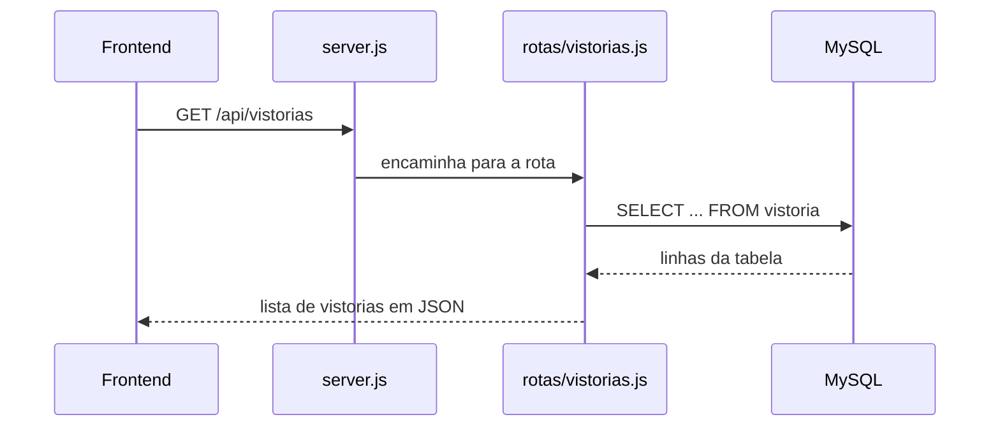

# 04 - Backend

O backend é um servidor feito em **Node.js** com a biblioteca **Express**. Ele recebe os pedidos do frontend, executa comandos SQL no **MySQL** e devolve a resposta em **JSON**.

## Bibliotecas utilizadas

| Biblioteca | Para que serve |
|---|---|
| `express` | Cria o servidor e as rotas |
| `mysql2` | Conecta o Node.js ao MySQL |

## Arquivos

| Arquivo | O que faz |
|---|---|
| `src/server.js` | Inicia o servidor na porta 3000 e registra as rotas |
| `src/db.js` | Configura a conexão com o MySQL |
| `src/rotas/login.js` | Rota de login |
| `src/rotas/usuarios.js` | Rotas de usuários e cargos |
| `src/rotas/vistorias.js` | Rotas de vistorias |
| `src/rotas/ocorrencias.js` | Rotas de ocorrências |

## Como funciona uma requisição

Exemplo: o frontend pede a lista de vistorias.



1. O frontend faz um pedido para `http://localhost:3000/api/vistorias`.
2. O `server.js` direciona o pedido para o arquivo de rotas certo.
3. A rota executa um comando SQL usando a conexão de `db.js`.
4. O resultado é devolvido ao frontend em formato JSON.

### Exemplo de rota

```js
// GET /api/usuarios/:id - busca um usuário
router.get('/usuarios/:id', async (req, res) => {
  const [usuarios] = await db.query(
    'SELECT id, nome, email, id_cargo FROM usuario WHERE id = ?',
    [req.params.id]
  );

  if (usuarios.length === 0) {
    return res.status(404).json({ erro: 'Usuário não encontrado' });
  }
  res.json(usuarios[0]);
});
```

- `router.get` → define que a rota responde a pedidos do tipo **GET**.
- `req` → tudo o que chegou no pedido (`req.params`, `req.query`, `req.body`).
- `res` → usado para devolver a resposta (`res.json(...)`).
- `await db.query(...)` → executa o SQL e espera o resultado.
- O `?` no SQL é substituído pelo valor da lista `[...]`. Isso evita montar o SQL juntando textos e protege contra *SQL Injection*.

### Onde chegam os dados

| Origem | Exemplo | Como ler |
|---|---|---|
| Parte da URL | `/api/vistorias/5` | `req.params.id` |
| Filtro na URL | `/api/vistorias?status=ABERTA` | `req.query.status` |
| Corpo (JSON) | `{ "nome": "Maria" }` | `req.body.nome` |

### Métodos HTTP

| Método | Uso |
|---|---|
| GET | Buscar dados |
| POST | Cadastrar |
| PUT | Alterar |
| DELETE | Excluir |

## Login e permissões

1. O frontend envia e-mail e senha para `POST /api/login`.
2. O backend procura um usuário com esse e-mail e senha.
3. Se encontrar, devolve os dados do usuário, o **cargo** e a lista de **permissões**.
4. O frontend guarda esses dados (`localStorage`) e mostra apenas os botões e telas permitidos ao cargo.

Exemplo de resposta do login:
```json
{
  "id": 1,
  "nome": "Ana Analista",
  "email": "analista@vistoria.com",
  "id_cargo": 1,
  "cargo": "Analista",
  "permissoes": ["GERENCIAR_USUARIOS", "GERENCIAR_VISTORIAS", "VISUALIZAR_VISTORIAS", "VISUALIZAR_OCORRENCIAS"]
}
```

## Lista de rotas

Endereço base: `http://localhost:3000/api`

### Login

| Método | Rota | Corpo |
|---|---|---|
| POST | `/login` | `{ email, senha }` |

### Usuários

| Método | Rota | Corpo |
|---|---|---|
| GET | `/cargos` | — |
| GET | `/usuarios` | — |
| GET | `/usuarios/:id` | — |
| POST | `/usuarios` | `{ nome, email, senha, idCargo }` |
| PUT | `/usuarios/:id` | `{ nome, email, senha, idCargo }` |
| DELETE | `/usuarios/:id` | — |

### Vistorias

| Método | Rota | Corpo |
|---|---|---|
| GET | `/vistorias?status=&endereco=` | — |
| GET | `/vistorias/:id` | — (devolve também fotos e ocorrências) |
| POST | `/vistorias` | `{ idUsuarioCriador, idOperadorResponsavel, descricao, endereco, urlFoto }` |
| POST | `/vistorias/:id/fotos` | `{ urlFoto }` |
| PUT | `/vistorias/:id` | `{ idOperadorResponsavel, descricao, endereco, status }` |
| DELETE | `/vistorias/:id` | — |

### Ocorrências

| Método | Rota | Corpo |
|---|---|---|
| GET | `/ocorrencias?idVistoria=` | — |
| GET | `/ocorrencias/:id` | — (devolve também as fotos) |
| POST | `/ocorrencias` | `{ idVistoria, idUsuarioCriador, classificacao, descricao, urlFoto }` |
| PUT | `/ocorrencias/:id` | `{ classificacao, descricao }` |
| DELETE | `/ocorrencias/:id` | — |

## Testando as rotas

O arquivo [`requisicoes.http`](requisicoes.http) tem exemplos prontos de todas as rotas. Para usar, instale a extensão **REST Client** no VS Code e clique em **Send Request** acima de cada exemplo. Também é possível usar o Postman ou o Insomnia.

### Chamando a API pelo frontend

```js
const resposta = await fetch('/api/vistorias');
const vistorias = await resposta.json();
console.log(vistorias);
```
