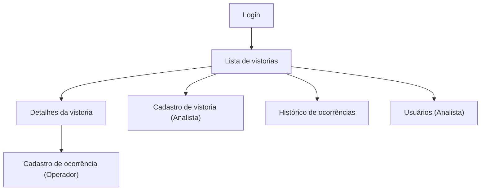

# 05 - Telas

Descrição das telas para o protótipo (Figma ou Marvel) e para o frontend em HTML, CSS, JavaScript e Bootstrap.

Link do protótipo: _a definir_

## Navegação

## Login
- Campos de e-mail e senha e botão **Entrar**.
- Mensagem de erro se os dados estiverem incorretos.

## Lista de vistorias
- Menu superior com o nome do usuário e o botão **Sair**.
- Filtros: status e endereço.
- Para cada vistoria: foto, código, status, data de abertura, responsável e descrição.
- Analista: botões **Nova vistoria**, **Editar** e **Excluir**.
- Todos: botão **Ver detalhes**.

## Cadastro de vistoria (Analista)
- Campos: endereço, descrição, operador responsável (lista) e link da foto.
- Na edição, também o campo status (Aberta / Finalizada).

## Detalhes da vistoria
- Dados da vistoria e suas fotos.
- Lista de ocorrências com classificação, data e descrição.
- Operador: botão **Nova ocorrência**.

## Cadastro de ocorrência (Operador)
- Campos: classificação (Baixa / Média / Alta / Crítica), descrição e link da foto.

## Histórico de ocorrências
- Tabela com data, endereço da vistoria, classificação, descrição e operador.

## Usuários (Analista)
- Tabela com nome, e-mail e cargo; botões **Novo**, **Editar** e **Excluir**.
- Formulário: nome, e-mail, senha e cargo.
