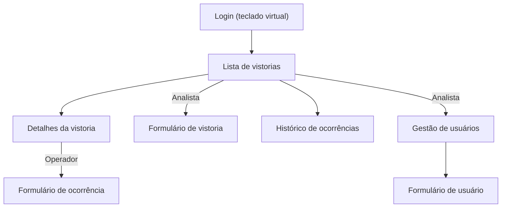

# 05 - Telas (guia para o protótipo)

Descrição das telas para montar o protótipo no **Figma** (ou Marvel) e depois o frontend com **HTML + CSS + Bootstrap + JavaScript**.

> Link do protótipo: _adicionar aqui quando estiver pronto_

## Mapa de navegação

## T01 - Login
- Campo de **e-mail** (teclado normal).
- Campo de **senha somente leitura** (`readonly`), preenchido por um **teclado virtual** na tela.
  - Botões com os dígitos 0–9 em **ordem embaralhada** a cada acesso, botão "Apagar" e "Limpar".
  - A senha aparece mascarada (`••••••`).
- Botão **Entrar**. Mensagem de erro em caso de credenciais inválidas.

## T02 - Lista de vistorias (tela inicial)
- Barra superior: nome do usuário, cargo, menu (Vistorias, Histórico, Usuários*), botão Sair.
- **Filtros:** status, endereço, responsável, data inicial e final.
- **Cards ou tabela** com: foto do local, identificador (#ID), status (badge colorido), data de abertura, nome do responsável, descrição resumida e quantidade de ocorrências.
- Analista: botão **Nova vistoria**, ações **Editar** e **Excluir**.
- Todos: ação **Ver detalhes**.

## T03 - Formulário de vistoria (Analista)
- Endereço, descrição/informações iniciais, operador responsável (select), foto(s) do local.
- Na edição: campo **status** (Aberta / Em andamento / Finalizada).

## T04 - Detalhes da vistoria
- Dados completos da vistoria + galeria de fotos.
- Lista de ocorrências (classificação com badge, data, autor, descrição).
- Operador: botão **Nova ocorrência** (oculto se a vistoria estiver finalizada).

## T05 - Formulário de ocorrência (Operador)
- Classificação (Baixa / Média / Alta / Crítica), descrição, foto(s).

## T06 - Histórico de ocorrências
- Filtros: vistoria, classificação, período.
- Tabela: data, vistoria/endereço, classificação, descrição, autor.

## T07 - Gestão de usuários (Analista)
- Tabela de usuários (nome, e-mail, cargo) com filtros, botões Novo, Editar, Excluir.
- Formulário: nome, e-mail, senha, cargo.

## Padrão visual sugerido

| Elemento | Bootstrap |
|---|---|
| Status ABERTA | `badge bg-secondary` |
| Status EM_ANDAMENTO | `badge bg-warning` |
| Status FINALIZADA | `badge bg-success` |
| Classificação BAIXA | `badge bg-info` |
| Classificação MEDIA | `badge bg-warning` |
| Classificação ALTA | `badge bg-danger bg-opacity-75` |
| Classificação CRITICA | `badge bg-danger` |
